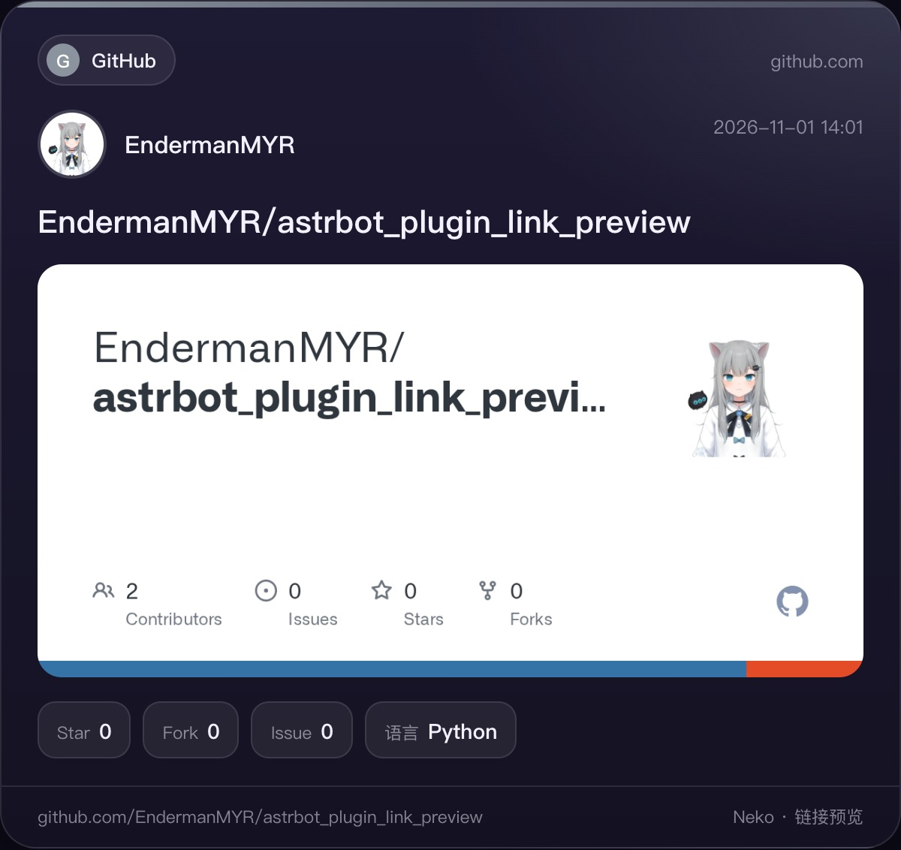
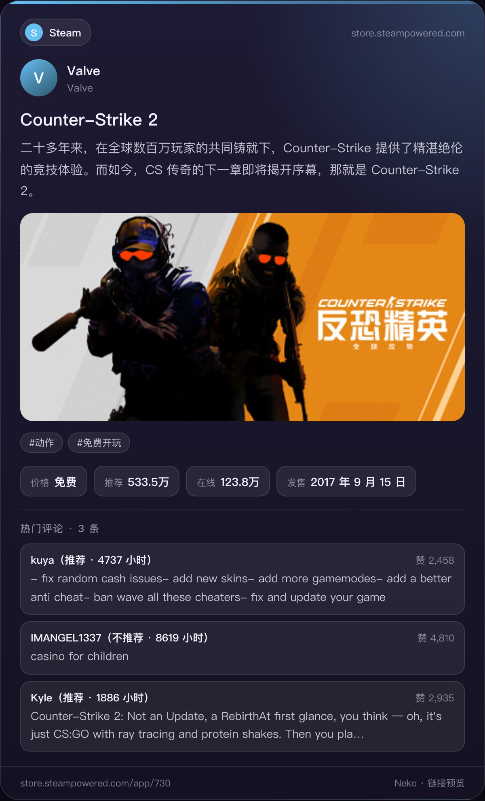
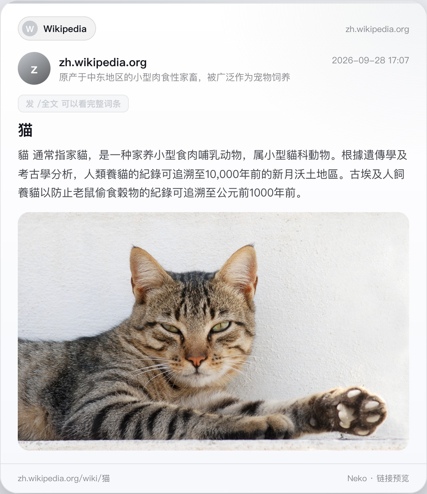

# ✨ 外链预览 | Link Preview (AstrBot Plugin)


## ✅ 简介 | Introduction

<table>
  <tr>
    <td width="190" align="center">
      
    </td>
    <td>
      <strong>Link Preview · 外链预览</strong><br />
      YouTube · TikTok · X · pixiv · Wikipedia<br />
      <sub>群里发一条链接，回一张排版好的卡片图。</sub>
    </td>
  </tr>
</table>

这是一个为 **AstrBot** 编写的插件：群聊里有人发国外平台的链接时，自动抓取标题、作者、正文、配图、数据和热门评论，用 Playwright 在本地渲染成一张卡片图片发回群里。

[](https://github.com/EndermanMYR/astrbot_plugin_link_preview/stargazers)
[](https://github.com/EndermanMYR/astrbot_plugin_link_preview/issues)
[](https://github.com/EndermanMYR/astrbot_plugin_link_preview/pulls)
[](https://github.com/EndermanMYR/astrbot_plugin_link_preview/commits/main)

> [!IMPORTANT]
> 卡片由容器内的 **Playwright Chromium** 在本机渲染，不走第三方截图接口。浏览器不可用时会自动退回 AstrBot 自带的文转图服务，此时排版会有差异。

> [!WARNING]
> 插件内置的屏蔽词**不可能覆盖所有敏感内容**，转发抓取内容存在账号被限制或封禁的风险。**使用前请阅读 [免责声明](#️-免责声明--disclaimer)，风险与合规责任由部署者自行承担。**

## ✅ 功能列表 | Features

- **自动识别**：群消息里出现链接就自动出卡片，不需要 @ 或指令
- **19 个平台**：YouTube、TikTok、Instagram、X、GitHub、Bluesky、pixiv、Steam、Reddit、维基百科、维基文库、Dailymotion、niconico、Spotify、Vimeo、SoundCloud、Threads、Twitch、Facebook
- **热门评论**：YouTube、TikTok、X、GitHub Issue/PR、Bluesky、pixiv 的卡片会附带几条高赞评论
- **评论单独看**：`/评论` 出一张只放评论的卡，最多 10 条
- **维基全文**：`/全文` 把词条或维基文库作品分页渲染，合并转发发出，中文按简体显示
- **敏感词屏蔽**：内置约 150 个政治敏感词，中文支持插字写法识别，命中的评论单独剔除
- **R18 过滤**：词表 + 平台敏感标记双重判断，命中整条不发
- **出站检查**：机器人自己要发的消息（含合并转发里的文字）也会在发送前过一遍词表
- **按群开关配图**：`/预览图片` 让管理员单独控制本群卡片是否显示配图
- **深色/浅色主题**：一张配置切换
- **去重**：同一链接在同一个群里 30 秒内只预览一次

<table>
  <tr>
    <td width="50%" align="center" valign="top"></td>
    <td width="50%" align="center" valign="top"></td>
  </tr>
  <tr>
    <td width="50%" align="center" valign="top"></td>
    <td width="50%" align="center" valign="top"></td>
  </tr>
</table>

## 🌐 平台支持 | Platforms

| 平台 | 抓取内容 | 评论 |
|---|---|---|
| YouTube | 标题、频道、简介、封面、时长、播放/点赞 | ✔ 热门评论 |
| TikTok | 视频封面或图集、作者、播放/点赞/评论/分享/收藏 | ✔ 按点赞排序 |
| Instagram | 帖子和 Reels 的作者、配文、图片（通过公开的嵌入修复站读取） | ✘ 需要登录 |
| X / Twitter | 正文、作者、配图、引用帖、回复/转帖/喜欢/浏览 | ✔ 需配置 X 浏览器服务（较慢，自动预览最多等 15 秒） |
| GitHub | 仓库、Issue、PR、用户主页 | ✔ Issue/PR 评论 |
| Bluesky | 正文、作者、配图、互动数 | ✔ 按点赞排序的回复 |
| pixiv | 标题、作者、标签、数据（R-18 不显示图片） | ✔ |
| Reddit | 标题、作者、版块 | ✘ 服务器访问被拦 |
| Steam | 名称、简介、价格、类型、推荐数 | ✘ 评测接口被拦 |
| 维基百科 | 词条摘要、配图 | — |
| 维基文库 | 作品名、作者、朝代、出处、开头正文；整部书的目录页显示章节列表 | — |
| Dailymotion | 标题、作者、封面、时长、播放/点赞、标签 | — |
| niconico | 标题、作者、封面、时长、播放/评论/收藏、标签 | — |
| Spotify / Vimeo / SoundCloud | 标题、作者、封面 | — |
| Threads / Twitch / Facebook | 页面元信息（要登录的页面不发） | — |

不在列表里的网址，用 `/预览 链接` 会按普通网页抓 OpenGraph 信息。

## 📦 安装 | Installation

将插件目录放入：

```
AstrBot/data/plugins/astrbot_plugin_link_preview
```

重启 AstrBot 后即可在 WebUI 中看到插件。

容器需要 Chromium 的系统依赖，否则渲染会一路退回文转图：

```bash
python -m playwright install-deps chromium
# emoji 显示需要
apt install -y fonts-noto-color-emoji
```

## ⚙️ 配置 | Configuration

插件使用 `_conf_schema.json` 定义配置，入口：

```
AstrBot WebUI -> 插件 -> 插件配置
```

### 🔧 基础

| 配置项 | 说明 |
|--------|------|
| `enabled` | 启用自动识别 |
| `platforms` | 分平台开关，默认全开 |
| `max_links_per_message` | 一条消息最多预览几个链接，默认 `2` |
| `dedupe_seconds` | 同一链接在同一个群里多久内不重复预览，默认 `30` |
| `private_enabled` | 私聊里也自动识别，默认关 |
| `group_whitelist` / `group_blacklist` | 只在这些群 / 不在这些群自动识别 |

### 🎨 卡片外观

| 配置项 | 说明 |
|--------|------|
| `theme` | 卡片主题：`dark` / `light` |
| `text_length` | 正文最多显示多少字，默认 `420` |
| `show_images` | 显示配图和封面 |
| `blur_sensitive` | 平台标记为敏感的图片自动模糊 |
| `comment_count` | 卡片里显示几条热门评论，默认 `3`，最大 `10` |

### 🌐 网络与抓取

| 配置项 | 说明 |
|--------|------|
| `proxy` | 访问国外平台用的代理，如 `http://127.0.0.1:7890` |
| `github_token` | GitHub Token（可选），提高 API 限额 |
| `fetch_timeout` | 抓取超时（秒），默认 `12` |
| `render_timeout` | 渲染超时（秒），默认 `25` |

### 🐦 X 评论

| 配置项 | 说明 |
|--------|------|
| `x_comments` | X 帖子也抓评论 |
| `x_comments_wait` | 自动预览时 X 评论最多等几秒，默认 `15` |
| `x_browser_url` / `x_browser_token` | X 浏览器服务地址和 Token（抓取 X 评论用） |

X 卡片本身走公开接口，不需要登录；只有「热门评论」需要一台登录过 X 的浏览器。这套服务已经随插件放在 [`x-browser-service/`](x-browser-service/README.md)，用 Docker 起两个容器即可：

```bash
cd x-browser-service
cp .env.example .env      # 填管理 Token 和 HTTPS 登录域名
docker compose up -d
```

部署完把地址和 Token 填进 `x_browser_url` / `x_browser_token`。不部署也不影响其他平台，只是 X 卡片没有评论。

### 📖 维基全文

| 配置项 | 说明 |
|--------|------|
| `full_page_chars` | 每页大约多少字，默认 `3500` |
| `full_max_pages` | 最多发几页，默认 `15` |

### 🛡️ 屏蔽

| 配置项 | 说明 |
|--------|------|
| `block_enabled` | 启用敏感词屏蔽 |
| `block_words_file` | 词表文件；留空用插件数据目录下的 `political.txt` |
| `block_words` | 额外屏蔽词 |
| `block_mode` | 命中后怎么处理：`整条不发` / `打码后发送` |
| `block_outgoing` | 机器人自己的回复也检查，默认开 |
| `r18_enabled` | 启用 R18 过滤 |
| `r18_block_flagged` | 平台标记为敏感的也整条不发 |
| `r18_words_file` | R18 词表；留空用插件数据目录下的 `r18.txt` |
| `r18_outgoing` | 机器人自己的回复也查 R18，默认关 |
| `block_notice` | 被拦截或发不出去时在群里提醒 |

## 📌 使用说明 | Usage

### 💬 指令

| 指令 | 别名 | 说明 |
|------|------|------|
| `/预览 链接` | `/preview` | 手动预览任意网页，不受平台开关限制 |
| `/评论 [链接]` | `/comments`、`/看评论` | 单独看评论（最多 10 条），不带链接时用本群最近预览的那条 |
| `/全文 [维基链接]` | `/fulltext`、`/维基全文` | 维基百科词条或维基文库作品全文，分页后合并转发 |
| `/预览图片 [开/关/默认]` | `/previewimg`、`/预览配图` | 管理员切换本群卡片是否显示配图和封面 |
| `/预览帮助` | `/previewhelp` | 查看帮助 |

> [!NOTE]
> `/全文` 的合并转发只有 QQ（OneBot / aiocqhttp）支持，其他平台会逐张发送。每页约 3500 字，最多 15 页，超出部分会提示看原文。

### 🛡️ 敏感词与 R18

- 词表默认放在插件数据目录：`data/plugin_data/astrbot_plugin_link_preview/political.txt`，第一次加载时用插件自带的 `sensitive_words.txt` 创建，之后改这个文件即可，改完立即生效
- 从旧版本升级时，如果插件数据目录里还没有词表、而旧位置 `data/sensitive_words/political.txt` 存在，会先复制一份过来再继续；旧文件保留不动
- 想放在别处，把 `block_words_file` 填成绝对路径或相对 AstrBot 工作目录的路径即可
- 自带词表约 150 个政治敏感词（简繁体），刻意避开了「64」「民主」这类会大量误伤的短词
- 中文词去掉空格、间隔号、星号等插字后匹配；英文词按整词匹配
- 正文、标题、作者命中：默认整条不发，也可以设成打码后发送；评论命中只去掉那一条
- 按账号屏蔽：X 帖子作者的简介（和所在地）里带敏感词或 R18 词，不管这条帖子发的是什么都不预览
- 维基 `/全文` 不做 R18 检查；机器人自己的回复默认也不查（`r18_outgoing`）

### 📤 发不出去时

- 命中屏蔽词：链接卡片、`/全文` 和机器人自己的回复都会在群里提醒一句（`block_notice`，默认开）
- 卡片被 QQ 拒收（比如图片没过 QQ 审核）：改发一句文字提醒

## 🧭 网络代理建议 | Network Proxy

插件要访问的多数平台在境外，服务器直连大概率超时。推荐给 Clash 加一条规则，或在配置里直接填 `proxy`：

```yaml
mixin:
  mode: rule

  proxy-groups:
    - name: LINK-PREVIEW
      type: select
      proxies:
        - HK   # ← 改成你的节点
        - DIRECT

  rules:
    - DOMAIN-SUFFIX,youtube.com,LINK-PREVIEW
    - DOMAIN-SUFFIX,ytimg.com,LINK-PREVIEW
    - DOMAIN-SUFFIX,tiktokcdn.com,LINK-PREVIEW
    - DOMAIN-SUFFIX,twitter.com,LINK-PREVIEW
    - DOMAIN-SUFFIX,x.com,LINK-PREVIEW
    - DOMAIN-SUFFIX,twimg.com,LINK-PREVIEW
    - DOMAIN-SUFFIX,bsky.app,LINK-PREVIEW
    - DOMAIN-SUFFIX,pixiv.net,LINK-PREVIEW
    - DOMAIN-SUFFIX,pximg.net,LINK-PREVIEW
    - DOMAIN-SUFFIX,dailymotion.com,LINK-PREVIEW
    - DOMAIN-SUFFIX,niconico.com,LINK-PREVIEW
    - DOMAIN-SUFFIX,githubusercontent.com,LINK-PREVIEW

    - MATCH,DIRECT
```

> [!TIP]
> 维基百科、维基文库、GitHub、Steam 国内多数网络可直连，不必走代理；只把上面这些走代理能省不少流量。

## 🧪 开发验证 | Development

插件不依赖 AstrBot 就能单独跑抓取和渲染，方便调模板：

```bash
pip install httpx jinja2 playwright
python -m playwright install chromium
```

抓取一张卡片并渲染成图片：

```python
import asyncio, fetchers, render
from playwright.async_api import async_playwright

async def main():
    async with fetchers.make_client(None, 15) as c:
        card = await fetchers.fetch(c, "github",
            "https://github.com/EndermanMYR/astrbot_plugin_link_preview", comments=3)
        card = await render.prepare(c, card)
    html = render.build_html(card, "dark")
    async with async_playwright() as p:
        b = await p.chromium.launch()
        pg = await b.new_page(viewport={"width": 680, "height": 900}, device_scale_factor=2)
        await pg.set_content(html, wait_until="load")
        await pg.evaluate("document.fonts.ready")
        el = await pg.query_selector("#card")
        await el.screenshot(path="card.jpg", type="jpeg", quality=92)
        await b.close()

asyncio.run(main())
```

`fetchers.py` 和 `render.py` 都不 import `astrbot`，可以直接在本地改模板看效果。上面 `docs/images/` 里的展示图就是这么生成的。

## ❤️ 致谢 | Credits

- 卡片渲染基于 [Playwright](https://playwright.dev/)
- 抓取基于 [httpx](https://www.python-httpx.org/)，模板基于 [Jinja2](https://jinja.palletsprojects.com/)

## ⚠️ 免责声明 | Disclaimer

> [!WARNING]
> 本插件会从第三方平台抓取内容并转发到群聊。**是否合规使用由部署者自行判断并承担全部责任。** 内置的敏感词表与 R18 词表只是辅助手段，**不构成内容审核，也不保证覆盖任何一类敏感内容**。

### 一、屏蔽词表不保证完整

插件自带约 150 个政治敏感词和一份 R18 词表，是作者按个人经验整理的，**覆盖面必然有限**。实际内容里存在大量词表无法覆盖的形态：

- 谐音、缩写、拼音首字母、外语、方言、拆字
- 图片、视频、表情包里的文字（词表只检查文本字段）
- 平台自身未打敏感标记的成人内容（R18 判定部分依赖平台标记）
- 新出现的敏感表述，词表更新必然滞后

因此**不能把本插件当作内容审核工具**，更不应据此认为「没被拦截就是安全的」。词表支持自行修改和追加，建议按自己的使用场景维护。

### 二、内容来自第三方

卡片上的标题、正文、作者、配图、评论均抓取自 YouTube、TikTok、X、pixiv 等平台，由第三方用户生成。作者无法控制这些内容，也不对其真实性、准确性、合法性、是否侵犯第三方权利作任何担保。

### 三、账号风险由使用者承担

使用本插件可能导致账号被平台限制、封禁，或导致机器人无法继续使用，包括但不限于：

| 情形 | 可能的后果 |
|---|---|
| 抓取到的内容违反平台服务条款或当地法律法规 | 机器人账号被封禁、群聊被限制 |
| 词表未覆盖的敏感内容被转发到群聊 | 群聊被封、账号被处罚 |
| 高频抓取触发目标平台风控或限流 | X / TikTok 等账号被临时或永久限制 |
| 机器人所在平台对转发内容进行审核处置 | 消息被拦截、账号被降权 |

**因使用本插件造成的账号封禁、限流、内容删除、服务中断、数据丢失，或任何其他直接、间接损失，作者不承担任何责任。**

### 四、部署者的合规义务

部署者应自行确认所在地区法律法规、机器人平台服务条款、目标平台使用条款是否允许此类抓取与转发行为。建议：

- 按自身场景维护词表，不要直接依赖默认词表
- 优先在私密群或小范围使用，避免公开传播抓取内容
- 遵守目标平台的 robots 与 API 条款，控制请求频率
- 涉及成人内容的场景，确保使用者均为成年人
- 定期检查机器人所在平台的规则变化

### 五、接口与可用性

插件依赖第三方公开接口与网页结构，随时可能因对方改版、限流、封锁而失效。作者不保证插件持续可用，也不对因此产生的任何后果负责。

### 六、许可与担保

代码以 MIT 许可发布，意为「按原样提供」（AS IS），**不附带任何明示或暗示的担保**，包括但不限于适销性、特定用途适用性和不侵权担保。详见 [LICENSE](LICENSE)。

## 📜 许可证 | License

本项目基于 [MIT License](LICENSE) 发布，可自由使用、修改和分发，保留版权声明即可。

[](LICENSE)
